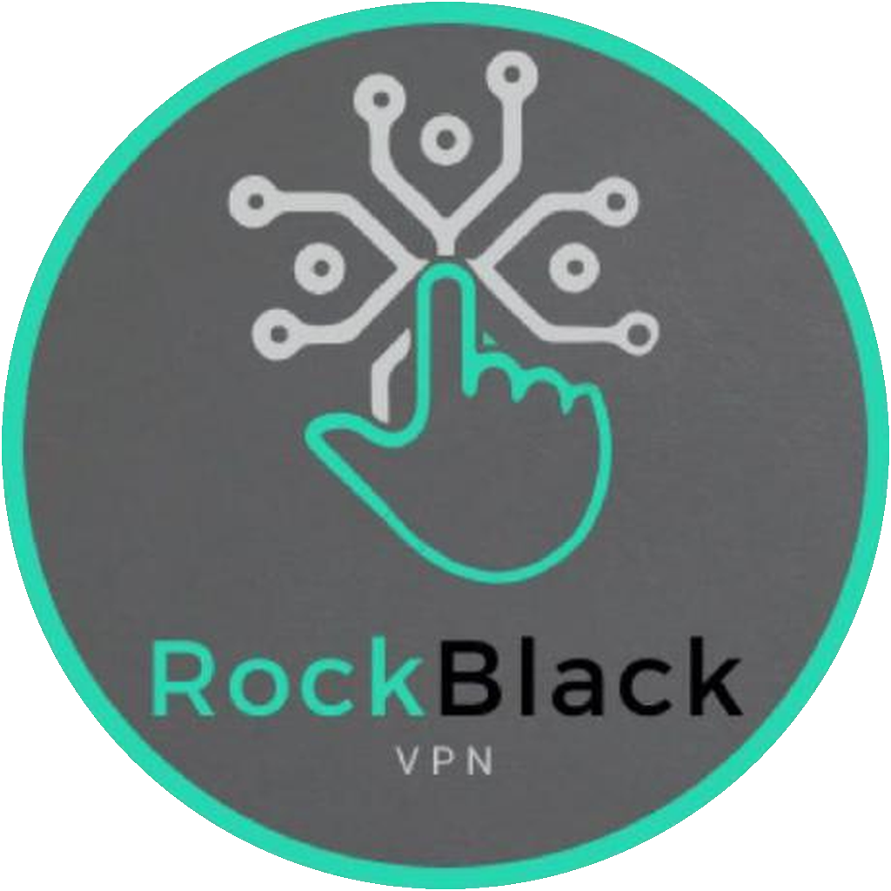

# RockBlack

**Cross-platform proxy client built on [Xray-core](https://github.com/XTLS/Xray-core)**

## Downloads

### Android

| Platform | Link |
|:---------|:-----|
| Android / Android TV (universal) | [Download APK](https://github.com/RockBlack-VPN/rockblack/releases/download/latest/RockBlack.apk) |
| Per-architecture APKs | [Android releases](https://github.com/RockBlack-VPN/rockblack/releases?q=Android&expanded=true) |

### Desktop

| Platform | Installer | Portable |
|:---------|:----------|:---------|
| Windows (x64) | [Setup](https://github.com/RockBlack-VPN/rockblack/releases/download/latest/rockblack-windows-x64-setup.exe) | [ZIP](https://github.com/RockBlack-VPN/rockblack/releases/download/latest/rockblack-windows-x64-portable.zip) |
| Windows (ARM64) | — | [ZIP](https://github.com/RockBlack-VPN/rockblack/releases/download/latest/rockblack-windows-arm64-portable.zip) |
| macOS (Apple Silicon) | [DMG](https://github.com/RockBlack-VPN/rockblack/releases/download/latest/rockblack-macos-arm64.dmg) | — |
| macOS (Intel) | [DMG](https://github.com/RockBlack-VPN/rockblack/releases/download/latest/rockblack-macos-intel.dmg) | — |
| Linux (x64) | [DEB](https://github.com/RockBlack-VPN/rockblack/releases/download/latest/rockblack-linux-x64.deb) · [RPM](https://github.com/RockBlack-VPN/rockblack/releases/download/latest/rockblack-linux-x64.rpm) | [ZIP](https://github.com/RockBlack-VPN/rockblack/releases/download/latest/rockblack-linux-x64-portable.zip) |
| Linux (ARM64) | [DEB](https://github.com/RockBlack-VPN/rockblack/releases/download/latest/rockblack-linux-arm64.deb) · [RPM](https://github.com/RockBlack-VPN/rockblack/releases/download/latest/rockblack-linux-arm64.rpm) | [ZIP](https://github.com/RockBlack-VPN/rockblack/releases/download/latest/rockblack-linux-arm64-portable.zip) |

> [!NOTE]
> macOS builds are not notarized. On first launch, right-click the app and choose **Open**,
> or run `xattr -cr /Applications/RockBlack.app`.

## Android updates with Obtainium

Android releases use **`android-vX.Y.Z`** (title **`Android vX.Y.Z`**).
Desktop releases use **`desktop-vX.Y.Z`**. Their versions are independent.

[Add RockBlack to Obtainium](https://apps.obtainium.imranr.dev/redirect?r=obtainium://app/%7B%22id%22%3A%22tech.rockblack.app%22%2C%22url%22%3A%22https%3A%2F%2Fgithub.com%2FRockBlack-VPN%2Frockblack%22%2C%22author%22%3A%22RockBlack-VPN%22%2C%22name%22%3A%22RockBlack%22%2C%22additionalSettings%22%3A%22%7B%5C%22filterReleaseTitlesByRegEx%5C%22%3A%5C%22%5EAndroid%20v%5B0-9%5D%2B%5C%5C%5C%5C.%5B0-9%5D%2B%5C%5C%5C%5C.%5B0-9%5D%2B%24%5C%22%2C%5C%22apkFilterRegEx%5C%22%3A%5C%22%5ERockBlack%5C%5C%5C%5C.apk%24%5C%22%2C%5C%22versionExtractionRegEx%5C%22%3A%5C%22%5B0-9%5D%2B%5C%5C%5C%5C.%5B0-9%5D%2B%5C%5C%5C%5C.%5B0-9%5D%2B%5C%22%2C%5C%22verifyLatestTag%5C%22%3Afalse%2C%5C%22fallbackToOlderReleases%5C%22%3Atrue%2C%5C%22includePrereleases%5C%22%3Afalse%7D%22%7D) · [Import configuration](obtainium.json)

For an existing Obtainium entry, use these settings:

| Setting | Value |
|:--------|:------|
| Source | `https://github.com/RockBlack-VPN/rockblack` |
| Filter release titles by regular expression | `^Android v[0-9]+\.[0-9]+\.[0-9]+$` |
| Filter APKs by regular expression | `^RockBlack\.apk$` |
| Version string extraction | `[0-9]+\.[0-9]+\.[0-9]+` |
| Verify Latest Tag | **Off** — `latest` combines independently versioned platforms |
| Fallback to older releases | **On** |

The download buttons use the permanent `latest` tag. [RELEASE.json](RELEASE.json)
keeps version-specific URLs for application updates. For publishing, see
[RELEASING.md](RELEASING.md).

## Protocols

`VLESS (Reality / XHTTP)` `VMess` `Trojan` `Shadowsocks` `Hysteria2` `TUIC` `WireGuard` `SOCKS5` `HTTP`

## Features

| | Android | Desktop |
|:--|:-:|:-:|
| **Subscriptions** — add by URL, QR code or share link, with auto-refresh | ✅ | ✅ |
| **Routing** — split traffic by domain/IP into proxy, direct or block, with custom DNS | ✅ | ✅ |
| **Full config import** — raw Xray JSON (and sing-box / mihomo on desktop) | ✅ | ✅ |
| **TLS fragmentation & mux** — configurable Xray fragment settings to get past DPI | ✅ | ✅ |
| **TUN mode** — system-wide VPN tunnel | ✅ | ✅ |
| **System proxy** — one-click system proxy with PAC / bypass rules | — | ✅ |
| **Per-app proxy** — route or exclude individual apps | ✅ | — |
| **Speed & latency test** — real delay test for every server | ✅ | ✅ |
| **Quick tile, widget & tray** — connect without opening the app | Tile · Widget | Tray |

**Privacy** — servers, keys and subscriptions never leave your device. RockBlack
sends no telemetry.

## Repository layout

| Path | Contents |
|:--|:--|
| [`desktop/`](desktop) | RockBlack Desktop — fork of [v2rayN](https://github.com/2dust/v2rayN) (.NET, Avalonia/WPF) |
| [`android/`](android) | RockBlack Android — fork of [v2rayNG](https://github.com/2dust/v2rayNG) (Kotlin) |
| [`ios/`](ios) | RockBlack iOS — SwiftUI app + packet tunnel on [libXray](https://github.com/XTLS/libXray) |
| [`branding/`](branding) | Logo, icons and naming/release conventions |
| [`scripts/`](scripts), [`tests/`](tests) | Release manifest and `latest` mirror tooling |
| [`.github/workflows/`](.github/workflows) | Builds and releases for every platform (GitHub Actions) |

Building from source: push to `main` builds every platform in GitHub Actions; the
artifacts are attached to each workflow run. See [RELEASING.md](RELEASING.md).

## Bug reports & feature requests

Open an issue at **[github.com/RockBlack-VPN/rockblack/issues](https://github.com/RockBlack-VPN/rockblack/issues)**.
Include the app version, your platform, and what you expected to happen instead.
For tunnel problems, attach the logs.

Website and support — **[my.rockblack.tech](https://my.rockblack.tech)**.

## Credits & license

RockBlack is a rebranded fork of the excellent open-source clients
**[v2rayN](https://github.com/2dust/v2rayN)** and **[v2rayNG](https://github.com/2dust/v2rayNG)** by 2dust
and contributors, and is powered by **[Xray-core](https://github.com/XTLS/Xray-core)**,
**[sing-box](https://github.com/SagerNet/sing-box)**, **[mihomo](https://github.com/MetaCubeX/mihomo)** and
**[hev-socks5-tunnel](https://github.com/heiher/hev-socks5-tunnel)**.
The list of changes relative to upstream is in [NOTICE.md](NOTICE.md).

Distributed under the [GNU General Public License v3.0](LICENSE), like the upstream projects.

## Legal

RockBlack is a client application. Users are responsible for the servers they connect to
and must comply with local laws.
